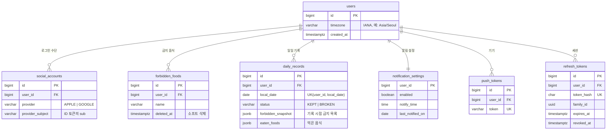

# DB 스키마: 먹참

- 작성일: 2026-10-20
- 상태: 초안 (V1 마이그레이션 기준)
- 관련 문서: [PRD](PRD.md), [기술 스택](TECH_STACK.md)
- 마이그레이션: [`V1__init.sql`](../backend/src/main/resources/db/migration/V1__init.sql)

> **요약**
> - 테이블 7개: `users`, `social_accounts`, `forbidden_foods`, `daily_records`, `notification_settings`, `push_tokens`, `refresh_tokens`
> - 핵심은 `daily_records`의 `(user_id, local_date)` 유니크 제약. 하루 한 건이고, 다시 기록하면 덮어쓴다.
> - 기록 시점의 금지 목록과 먹은 음식을 `jsonb` 스냅샷으로 저장한다. 금지 목록이 바뀌어도 과거 기록의 의미가 유지된다.

---

## 1. ERD

## 2. 테이블별 설계

### 2.1 `users`, `social_accounts`

- 사용자와 로그인 수단을 나눈다. 같은 사람이 Apple과 Google을 모두 연결할 수 있고, 나중에 다른 로그인 수단을 붙여도 `users`는 바뀌지 않는다.
- `(provider, provider_subject)`를 유니크로 둔다. 소셜 로그인에서 사용자를 식별하는 값은 이메일이 아니라 ID 토큰의 `sub`이다. Apple은 이메일을 숨기거나 처음 한 번만 주므로 `email`은 nullable 참고 정보로만 둔다.
- `users.timezone`은 IANA 이름(`Asia/Seoul`)으로 저장한다. UTC 오프셋으로 저장하면 서머타임이 있는 지역에서 날짜 계산이 틀어진다. 이름이 유효한지는 애플리케이션에서 `ZoneId.of()`로 검증한다.
- 계정 삭제(App Store 필수 요건)는 하드 삭제로 처리하고, 자식 테이블은 모두 `ON DELETE CASCADE`이다. 식습관 기록은 남길 이유가 없는 개인 데이터다(PRD 5.4 개인정보 최소 수집).

### 2.2 `forbidden_foods`

- 삭제는 소프트 삭제(`deleted_at`)로 한다. 과거 기록 스냅샷에 남아 있는 음식 ID를 음식별 잔디(F7)에서 계속 추적할 수 있다.
- 같은 사용자 안에서 **삭제되지 않은 음식끼리만** 이름이 겹치지 않게 부분 유니크 인덱스를 둔다. "라면"을 지웠다가 다시 추가할 수 있다.

### 2.3 `daily_records`: 핵심 테이블

| 컬럼 | 설명 |
| --- | --- |
| `local_date` | 사용자 타임존 기준 날짜. 하루 경계는 새벽 4시다(PRD 결정 3). 계산식: `((now() AT TIME ZONE tz) - interval '4 hours')::date` |
| `status` | `KEPT`(지킴) / `BROKEN`(어김). "미기록"은 행이 **없는** 것으로 표현한다 |
| `forbidden_snapshot` | 기록 시점의 금지 목록 `[{"id": 1, "name": "라면"}, ...]` |
| `eaten_foods` | 먹은 음식 `[{"id": 1, "name": "라면"}]`. `KEPT`면 빈 배열 |

- **하루 한 건:** `UNIQUE (user_id, local_date)`로 보장하고, 저장은 `INSERT ... ON CONFLICT (user_id, local_date) DO UPDATE`로 한다. 앱이 두 번 탭하거나 알림 버튼과 앱에서 동시에 기록해도 행은 하나만 남는다.
- **상태와 음식의 일관성:** `KEPT`면 `eaten_foods`가 비어 있고, `BROKEN`이면 하나 이상 있어야 한다. 이 규칙을 CHECK 제약으로 DB에서 강제한다(PRD 결정 1: 어김 시 음식 필수).
- **왜 jsonb인가:** 스냅샷은 "그 시점의 사실"이라 정규화된 참조로 두면 오히려 안 된다. 금지 음식 이름이 바뀌거나 삭제돼도 기록은 그대로 남아야 한다. 하루 한 행이라 덮어쓰기도 단순하다. 음식별 잔디(F7)는 `eaten_foods @> '[{"id": 1}]'` 같은 포함 연산으로 조회하고, 필요해지면 GIN 인덱스를 추가한다.
- **잔디 조회:** `(user_id, local_date)` 유니크 인덱스가 1년치 범위 조회(`local_date BETWEEN ...`)를 그대로 받쳐준다. 빈 날짜는 `generate_series`로 채우거나 앱에서 채운다.

### 2.4 `notification_settings`

- 사용자당 한 행(`user_id`가 PK). 가입할 때 기본값으로 만든다(`enabled = true`, `notify_time = 21:00`).
- `notify_time`은 사용자 로컬 시각이다. 스케줄러가 매분 돌면서 "지금 로컬 시각 = `notify_time`이고, 오늘 기록이 없고, 오늘 아직 안 보낸" 사용자를 찾는다.
- **중복 발송 방지:** `last_notified_on`을 `UPDATE ... SET last_notified_on = :today WHERE user_id = :id AND last_notified_on IS DISTINCT FROM :today RETURNING ...`으로 선점한다. 서버가 재시작되거나 스케줄러가 겹쳐 돌아도 하루 한 번만 보낸다.

### 2.5 `push_tokens`

- 한 사용자가 기기를 여러 대 쓸 수 있으므로 1:N이다.
- `token`은 전역 유니크다. 같은 기기에서 다른 계정으로 로그인하면 토큰 소유자를 새 사용자로 옮긴다(upsert).
- Expo Push가 `DeviceNotRegistered`를 돌려주면 해당 행을 삭제한다.

### 2.6 `refresh_tokens`

- 원문 대신 SHA-256 해시(`token_hash`)만 저장한다. DB가 유출돼도 토큰을 쓸 수 없다.
- **회전(rotation):** 재발급할 때마다 기존 토큰을 `revoked_at`으로 폐기하고 같은 `family_id`로 새 토큰을 만든다.
- **재사용 탐지:** 이미 폐기된 토큰이 다시 들어오면 탈취로 보고 같은 `family_id` 전체를 폐기한다.
- 기기(로그인 세션) 하나가 `family_id` 하나에 대응하므로 "이 기기에서 로그아웃"은 family 단위로 폐기하면 된다.

## 3. 공통 규칙

- PK는 `bigint GENERATED ALWAYS AS IDENTITY`를 쓴다.
- 시각은 모두 `timestamptz`(UTC 저장)를 쓰고, 날짜 의미가 있는 값만 `date`(`local_date`, `last_notified_on`)를 쓴다.
- 열거형 값은 PostgreSQL `enum` 대신 `varchar` + CHECK로 둔다. 값을 추가할 때 마이그레이션이 단순하고 JPA `@Enumerated(STRING)`과 바로 맞물린다.

## 4. 이번 버전에서 미룬 것

| 항목 | 미룬 이유 |
| --- | --- |
| 기록 정정 이력 테이블 | MVP에선 최종 상태만 의미가 있다. 정정을 분석할 필요가 생기면 `daily_record_histories`를 추가한다 |
| 스트릭·통계 캐시 컬럼 | 1년치는 최대 366행이라 조회할 때 계산해도 충분하다. 느려지면 기록 시점에 갱신하는 방식으로 바꾼다 |
| 소급 기록 허용 기간 | 스키마가 아니라 정책으로 다룬다. 애플리케이션에서 "최근 7일"(PRD 5.3 예시값)로 검증한다 |
| `eaten_foods` GIN 인덱스 | F7(Could)을 구현할 때 실제 쿼리를 보고 추가한다 |
